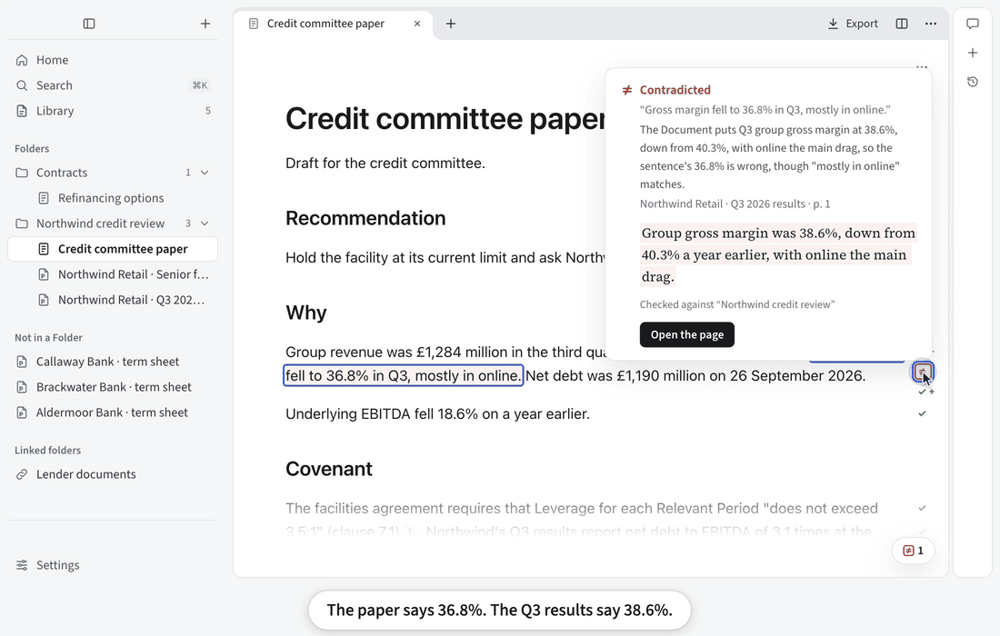

<!-- README.md and README.zh-CN.md match section for section. Change them together. -->

<p align="center"><b>English</b> · <a href="README.zh-CN.md">简体中文</a></p>

<p align="center">
  <picture>
    <source media="(prefers-color-scheme: dark)" srcset="build/icon/svg/mac-dark.svg">
    
  </picture>
</p>

<h1 align="center">IncarnaMind</h1>

<p align="center"><b>From messy files to a checked report.</b></p>

<p align="center">Write, ask questions, analyse spreadsheets and take meeting notes from your own files,<br>then check every sentence and figure against the page it came from.</p>

<p align="center"><a href="https://github.com/IncarnaMind/IncarnaMind/releases"></a>&nbsp;&nbsp;<a href="https://tally.so/r/rjN2jL?ref=readme"></a></p>

<p align="center">
  <a href="#download">macOS, Windows and Linux</a> ·
  <a href="#how-the-check-works">How the check works</a> ·
  <a href="#privacy">Privacy</a> ·
  <a href="https://github.com/IncarnaMind/IncarnaMind/discussions">Discussions</a>
  <br><br>
  
  <a href="https://github.com/IncarnaMind/IncarnaMind/releases"></a>
  <a href="LICENSE"></a>
  <a href="https://github.com/IncarnaMind/IncarnaMind/stargazers"></a>
</p>

<p align="center"></p>

<p align="center"><sub>Everything shown is in the app today. <a href="docs/images/demo-tour-2026-10-25-en.mp4">Watch the full film in HD</a>.<br>Alpha: free test builds, not yet signed. The public alpha opens in early 2027.</sub></p>

## Download

| System | File on the [Releases page](https://github.com/IncarnaMind/IncarnaMind/releases) |
|---|---|
| macOS (Apple silicon or Intel) | `.dmg` |
| Windows | `.exe` |
| Linux | `.deb` for Ubuntu and Debian, or `.AppImage` |

Test builds change often and aren't signed yet, so your system warns you the first time. Windows builds will be signed through the SignPath Foundation ([code signing policy](docs/code-signing-policy.md)).

<details>
<summary>If your system won't open it</summary>

- **Windows** says "Windows protected your PC": click **More info**, then **Run anyway**.
- **macOS** says it can't verify IncarnaMind: open it once and click **Done**, then **System Settings → Privacy & Security → Open Anyway**. Or run `xattr -dr com.apple.quarantine /Applications/IncarnaMind.app`. Until the app is notarized, it can't update itself, so it tells you when a new version is out.
- **Linux**: for the AppImage, run `chmod +x IncarnaMind-*.AppImage`. On Ubuntu 22.04 or later, also `sudo apt install libfuse2` (`libfuse2t64` on 24.04 and later). On 24.04 and later, the AppImage runs without the app's sandbox.

</details>

<details>
<summary>Run it from source</summary>

With Node.js 24 or newer:

```shell
git clone https://github.com/IncarnaMind/IncarnaMind.git && cd IncarnaMind
npm install && npm run dev
```

</details>

## What it does

| | |
|---|---|
| **Sort** | Link your folders. Organize suggests Folders and Tags. |
| **Ask** | Ask all your documents at once, every page cited. |
| **Write** | A Note is a notebook for one topic. The assistant's text stays grey until you edit it, and Undo takes it back. |
| **Analyse** | Calculate and chart from spreadsheets, every input cited. From the next test build. |
| **Check** | Check a Note or any PDF against your files, sentence by sentence. |
| **Compare** | Ask many documents the same questions and get one cited table. |
| **Export** | Edit a Word file and save it back: untouched parts stay exactly as they were, and your edits can go in as tracked changes. Or export a Note to Word with footnotes in eight citation styles. |
| **Meet** | A live transcript, help during the call, and notes that cite what was said. |

Works fully offline with [Ollama](https://ollama.com): nothing leaves your computer.

<details>
<summary><b>More</b></summary>

- Search OpenAlex, arXiv and PubMed for papers, save web pages, and import references from Zotero, BibTeX, RIS or CSL JSON.
- Add MCP servers and `SKILL.md` Skills. Anything that could change something asks you first.
- Give [Claude Code](docs/claude-code.md), [Codex](docs/codex.md) or [Cursor](docs/cursor.md) the Folders you choose, with checked citations (from the next test build).
- The whole app is in English and Chinese.

</details>

## How the check works

For each sentence, the check finds or reads the passages in your files that it relies on and marks whether they support it. The page is one click away.

Figures are compared as numbers. One rounded from the source passes, a different one is marked, and a calculated one shows its formula and where each input came from.

"Quote found" means the quoted words are on that page. Whether they prove your sentence is for you to judge, which is why the page opens with one click. And the check only compares your writing with your files, so a mistake in the files themselves gets through.

## How it compares

| | IncarnaMind | Gemini Notebook¹ | Open Notebook | AnythingLLM |
|---|:-:|:-:|:-:|:-:|
| Open source | ✓ | ✗ | ✓ | ◐ |
| Desktop app, no account | ✓ | ✗ | ◐ | ✓ |
| Reads local folders in place | ✓ | ✗ | ✗ | ◐ |
| Your ChatGPT or Claude plan, or your key | ✓ | ✗ | ◐ | ◐ |
| Citation opens the page, quote highlighted | ✓ | ◐ | ✗ | ✗ |
| Checks your own draft | ✓ | ✗ | ✗ | ✗ |
| Edits your Word file and saves it back | ✓ | ✗ | ✗ | ✗ |
| Spreadsheet analysis | ✓² | ✓ | ✗ | ◐ |
| Meetings | ✓ | ✗ | ✗ | ✓ |

<sub>✓ yes · ◐ partly, or not stated · ✗ not in their documentation. ¹ Formerly NotebookLM. ² From the next test build. From each product's documentation, October 2026: [Gemini Notebook](https://support.google.com/gemininotebook/), [Open Notebook](https://github.com/lfnovo/open-notebook), [AnythingLLM](https://docs.anythingllm.com/).</sub>

## Privacy

You don't need an account. IncarnaMind reads your files where they are and never changes them, and a question sends only what it needs to the model you picked.

| What | Where it goes |
|---|---|
| Your files, Notes and search index | Your computer |
| Questions, writing and checks | The model you picked, with only what each needs. With Ollama, nowhere |
| Meeting audio | Transcribed on your computer |
| Finding papers, tagging, scans, cloud transcription | Only after you say yes |
| Usage data and crash reports | Only if you turn them on, never with your files |
| API keys | Your system's secure storage |

Where a provider offers the choice, IncarnaMind asks it not to keep your requests. It can't make a provider comply. What each one sends, and how to turn it off, is in [docs/privacy.md](docs/privacy.md) and **Settings → Privacy**. For client work, read the [client data statement](docs/client-data-statement.md).

<details>
<summary><b>Questions</b></summary>

- **Is it free?** Yes, open source under Apache 2.0. The model is billed by its provider, or covered by a plan you already have.
- **How is it different from NotebookLM (now Gemini Notebook)?** It runs on your computer, reads your files where they are and needs no account. It works with the model you choose, opens each citation at its page, checks your own draft and exports to Word with footnotes. The table above has the rest.
- **Can a check miss something?** Yes: a check can miss a change of obligation, such as “should” where the Document says “may”.
- **Which models can I use?** Sign in with ChatGPT Plus or Pro, Claude, or GitHub Copilot (experimental); each stays off until you sign in. Or use your own key from OpenAI, Anthropic, Google, DeepSeek, Qwen, SiliconFlow, OpenRouter, Kimi, GLM, Mistral, xAI or any OpenAI-compatible server.
- **Does it work offline?** Reading files and search do. Answers and checks need a model: a cloud one, or a local one through Ollama, which is slower.
- **Can I use it on client documents?** Your files stay on your computer, and only the model you chose and the services you allow receive anything. Read the [client data statement](docs/client-data-statement.md) first.
- **Will it change my files?** No. It writes only to its own data folder and to the files you export.
- **How do I back up?** Copy the data folder. It holds your Notes, the search index and your settings.

</details>

## Contributing

Code, testing with your own documents, translations and ideas are all welcome. Start with [CONTRIBUTING.md](CONTRIBUTING.md), [open an issue](https://github.com/IncarnaMind/IncarnaMind/issues/new/choose) or ask in [Discussions](https://github.com/IncarnaMind/IncarnaMind/discussions).

## History

IncarnaMind began in 2023 as a Python tool for chatting with your PDFs, starred by about 800 of you. In 2026 it was rebuilt as a desktop app around one idea: an answer from your files is only useful if you can check it. The old tool is at the [`v1-python-cli`](https://github.com/IncarnaMind/IncarnaMind/tree/v1-python-cli) tag. If IncarnaMind helps you, a star helps other people find it.

<details>
<summary>Citing IncarnaMind</summary>

```bibtex
@misc{IncarnaMind2023, author = {Junru Xiong}, title = {IncarnaMind}, year = {2023},
  publisher = {GitHub}, journal = {GitHub Repository},
  howpublished = {\url{https://github.com/IncarnaMind/IncarnaMind}}}
```

</details>

## Licence

[Apache License 2.0](LICENSE). The bundled fonts (Source Serif 4, Source Sans 3, JetBrains Mono) are under the [SIL Open Font License 1.1](https://openfontlicense.org). The citation styles and locales come unmodified from the [Citation Style Language](https://citationstyles.org/) project under [CC BY-SA 3.0](https://creativecommons.org/licenses/by-sa/3.0/), formatted by [Hayagriva](https://github.com/typst/hayagriva) (MIT or Apache-2.0). Notices are in [`resources/notices`](resources/notices).
