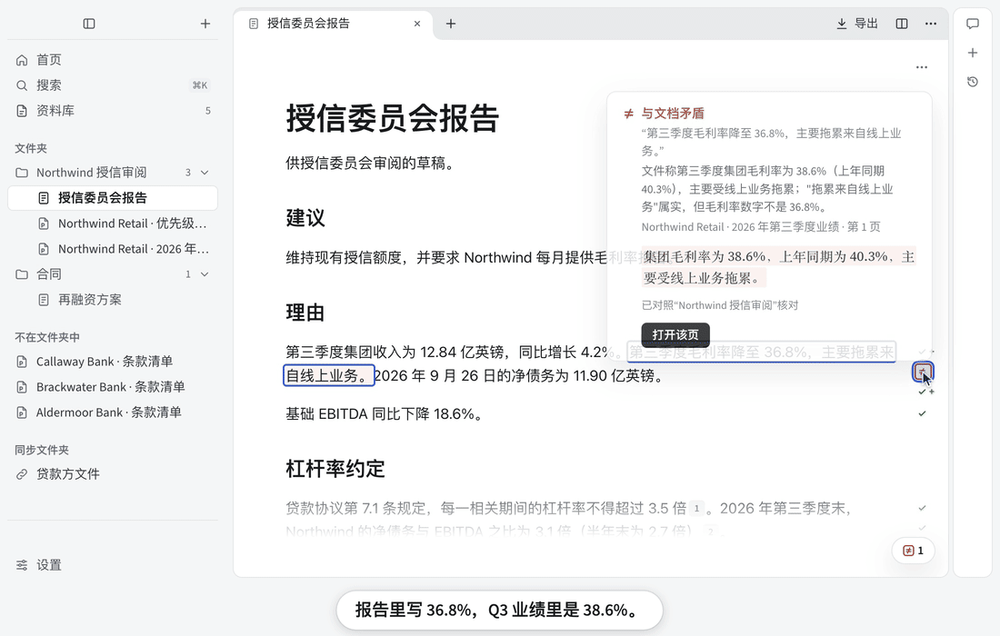

<!-- README.md 与 README.zh-CN.md 逐节对应，修改时请两份一起改。 -->

<p align="center"><a href="README.md">English</a> · <b>简体中文</b></p>

<p align="center">
  <picture>
    <source media="(prefers-color-scheme: dark)" srcset="build/icon/svg/mac-dark.svg">
    
  </picture>
</p>

<h1 align="center">IncarnaMind</h1>

<p align="center"><b>从一堆乱文件，到一份核对过的报告。</b></p>

<p align="center">写作、提问、分析数据、做会议笔记，都基于你自己的文件。<br>每一句话、每一个数字，都对照它出自的那一页核对。</p>

<p align="center">
  <a href="https://github.com/IncarnaMind/IncarnaMind/releases"><b>下载</b></a> ·
  <a href="#核对是怎么做的">核对是怎么做的</a> ·
  <a href="#你的文件始终归你">隐私</a> ·
  <a href="https://github.com/IncarnaMind/IncarnaMind/discussions">讨论区</a>
  <br><br>
  
  <a href="https://github.com/IncarnaMind/IncarnaMind/releases"></a>
  <a href="LICENSE"></a>
  <a href="https://github.com/IncarnaMind/IncarnaMind/stargazers"></a>
</p>

<p align="center"></p>

<p align="center"><sub>片中展示的功能现在都能用。<a href="docs/images/demo-tour-2026-10-25-zh-CN.mp4">观看高清完整版</a>。<br>Alpha 阶段：免费测试版，暂未签名。公开 alpha 将在 2027 年初开放（<a href="https://tally.so/r/LZA5aG?ref=readme-zh">上线时通知我</a>）。</sub></p>

## 为什么用 IncarnaMind

- **发出去之前先核对。** 草稿里的每一句话、每一个数字，都对照你的文件核对。
- **证据一点就到。** 每个回答都标出所在页，点开就能看到高亮的引文。
- **你的文件，你的格式。** PDF、Word、PowerPoint、Excel，在原处直接读取。
- **你的 AI。** 用你的 ChatGPT、Claude、Copilot 订阅，或你自己的密钥。不需要账号。
- **会议也在同一个资料库里。** 在你的电脑上转写，像文档一样可以引用。

## 它能做什么

| | |
|---|---|
| **整理** | 关联你平时用的文件夹，“整理”为每个文件推荐文件夹和标签。 |
| **提问** | 一次问遍你所有的文档，每个回答都标出用到的页。 |
| **写作** | 一篇笔记就是为一个主题准备的笔记本。告诉助手要改什么，它写的字在你修改前是灰色的，一键就能撤销。 |
| **分析** | 用你的表格计算、画图。每个输入都有引用，代码在你的电脑上运行，不联网。 |
| **核对** | 把一篇笔记或别人写的 PDF，逐句对照你的文件核对。 |
| **对比** | 向多份文档提出同样的问题，得到一张表，每一格都有引用。 |
| **导出** | 导出为 Word，带脚注和参考文献，支持八种引用格式；也能写回你打开的那个 Word 文件，没改动的部分原样保留。 |
| **会议** | 实时转写，通话中一键根据你的文件给出帮助，会后的笔记引用会上的原话。 |

配合 [Ollama](https://ollama.com) 可完全离线使用，内容不离开你的电脑。

<details>
<summary><b>更多</b></summary>

- **查找资料。** 在 OpenAlex、arXiv 和 PubMed 里搜索论文，保存网页，从 Zotero、BibTeX、RIS 或 CSL JSON 导入引用信息。
- **连接器和技能。** 添加 MCP 服务器和 `SKILL.md` 技能。凡是可能改动内容的操作，都会先问你。
- **用你自己的智能体。** 把你选的文件夹交给 [Claude Code](docs/claude-code.md)、[Codex](docs/codex.md) 或 [Cursor](docs/cursor.md)，引用都经过核对。
- **中英双语**，整个应用都是。

</details>

## 核对是怎么做的

- **核对就是拿每一句话去对照你的文件。** 它找出这句话依据的段落，标出这些段落是否支持它，原文一点就到。
- **数字按数值来读。** 从原文四舍五入来的数字算通过，不一样的会被标出；算出来的数字会给出算式，以及每个输入在哪一页。
- **“找到引文”是说这段文字确实在那一页，** 不代表它能证明你的句子，所以原文永远只差一次点击。
- **它对照的是你的文件，而不是整个世界。** 如果原文本身错了，核对发现不了。

## 和同类产品比较

| | IncarnaMind | Gemini Notebook（原 NotebookLM） | Open Notebook | AnythingLLM |
|---|---|---|---|---|
| 开源 | 是，Apache 2.0 | 否 | 是，MIT | 代码仓库是 MIT；桌面版另有条款 |
| 运行在哪里 | 桌面应用 | Google 云端 | 自行部署（Docker） | 桌面、自行部署或云端 |
| 账号 | 不需要 | Google 账号 | 不需要 | 桌面版不需要 |
| 在原处读取你的文件夹 | 是 | 否，保存副本 | 否，保存副本 | 部分，限单个文件 |
| 你的 AI | 你的密钥，或 ChatGPT、Claude、Copilot 订阅 | 只能用 Gemini | 你的密钥 | 你的密钥 |
| 点开引用就到那一页，引文高亮 | 是 | 在上下文中显示引文 | 只链接到整个来源 | 显示检索到的文本，没有页码 |
| 核对你自己写的草稿 | 是，逐句核对 | 否 | 否 | 否 |
| 长文档编辑器，导出带脚注的 Word | 是 | 只有简短笔记；能生成 Word 文件 | 否 | 智能体能生成 Word 文件 |
| 表格数据分析 | 是，代码在你的电脑上运行 | 是，在 Google 云端，取决于套餐 | 否 | 图表和 SQL 查询 |
| 会议 | 实时转写、通话中帮助、带引用的笔记 | 否 | 否 | 录音并总结（Mac、Windows） |

<sub>根据各产品 2026 年 10 月的官方文档：[Gemini Notebook 帮助中心](https://support.google.com/gemininotebook/)、[Open Notebook](https://github.com/lfnovo/open-notebook)、[AnythingLLM 文档](https://docs.anythingllm.com/)。</sub>

## 你的文件始终归你

不需要账号。你的文件在原处读取，从不改动；只有问题需要的内容，才会发给你选的 AI 模型。

| 内容 | 去向 |
|---|---|
| 你的文件、笔记和搜索索引 | 你电脑上的一个数据文件夹 |
| 提问、写作和核对 | 你选的 AI 模型：当前笔记、找到的段落、文档名和分析结果。用 Ollama 时哪儿也不去 |
| 会议录音 | 在你的电脑上转写 |
| 查找论文、自动打标签和整理、扫描页、云端转写 | 你同意后才会发送，每一项都列在**设置 → 隐私**里 |
| 使用数据和崩溃报告 | 你打开才会发送，绝不包括你的文件或问题 |
| API 密钥 | 系统自带的安全存储 |

只要服务提供这个选项，IncarnaMind 都会要求它不保存你的请求，但无法强制它照做。全部细节见 [docs/privacy.md](docs/privacy.md)；处理客户文件，请看[客户数据声明](docs/client-data-statement.zh-CN.md)。

## 下载

| 系统 | [Releases 页面](https://github.com/IncarnaMind/IncarnaMind/releases)上的文件 |
|---|---|
| macOS（Apple 芯片或 Intel） | `.dmg` |
| Windows | `.exe` |
| Linux | Ubuntu 和 Debian 用 `.deb`，或 `.AppImage` |

测试版更新频繁，暂未签名，第一次打开时系统会提示风险。Windows 版将通过 SignPath Foundation 签名（[代码签名政策](docs/code-signing-policy.md)）。

<details>
<summary>系统不让打开时</summary>

- **Windows** 提示“Windows 已保护你的电脑”：点**更多信息**，再点**仍要运行**。
- **macOS** 提示无法验证 IncarnaMind：先打开一次并点**完成**，再到**系统设置 → 隐私与安全性**里点**仍要打开**。也可以运行 `xattr -dr com.apple.quarantine /Applications/IncarnaMind.app`。完成公证之前，应用无法自动更新，有新版本时会提醒你。
- **Linux**：AppImage 需要先运行 `chmod +x IncarnaMind-*.AppImage`。Ubuntu 22.04 及以上还要运行 `sudo apt install libfuse2`（24.04 及以上是 `libfuse2t64`）。在 24.04 及以上，AppImage 不启用应用的沙盒。

</details>

<details>
<summary>从源代码运行</summary>

需要 Node.js 24 或更新版本：

```shell
git clone https://github.com/IncarnaMind/IncarnaMind.git && cd IncarnaMind
npm install && npm run dev
```

</details>

<details>
<summary><b>常见问题</b></summary>

- **要花钱吗？** 不用，开源免费（Apache 2.0 许可证）。AI 模型的费用由提供它的服务收取，或者由你已有的订阅承担。
- **和 NotebookLM（现名 Gemini Notebook）有什么不同？** 它在你的电脑上运行，文件在原处读取，不需要账号。模型由你来选，点开引用就到原文那一页，能核对你自己写的草稿，还能导出带脚注的 Word。其余见上面的比较表。
- **能用哪些 AI？** 最省事的是填一个 DeepSeek 密钥（设置里有“如何获取？”）。也可以用通义千问、硅基流动、Kimi、智谱 GLM、OpenAI、Anthropic、Google、OpenRouter、Mistral、xAI 的密钥，或任何兼容 OpenAI 接口的服务；还能直接登录 ChatGPT Plus 或 Pro、Claude、GitHub Copilot（实验性），登录之前不会启用。
- **能离线用吗？** 读取文件和搜索可以离线。回答和核对需要 AI 模型：云端模型，或通过 Ollama 运行的本地模型，后者更慢。
- **能用在客户文件上吗？** 你的文件留在你的电脑上，只有你选的模型和你允许的服务会收到内容。请先看[客户数据声明](docs/client-data-statement.zh-CN.md)。
- **会改动我的文件吗？** 不会。它只往自己的数据文件夹和你导出的文件里写内容。
- **怎么备份？** 复制数据文件夹就行，里面有你的笔记、搜索索引和设置。

</details>

## 参与贡献

欢迎贡献代码、用你自己的文档测试、翻译和提建议。请先看 [CONTRIBUTING.md](CONTRIBUTING.md)，或者[提一个 issue](https://github.com/IncarnaMind/IncarnaMind/issues/new/choose)，或在[讨论区](https://github.com/IncarnaMind/IncarnaMind/discussions)提问。

## 项目由来

IncarnaMind 始于 2023 年，最初是一个和 PDF 对话的 Python 工具，收获了约 800 个星标。2026 年，它围绕一个想法重写成桌面应用：基于你的文件给出的回答，只有能核对才有用。旧工具保留在 [`v1-python-cli`](https://github.com/IncarnaMind/IncarnaMind/tree/v1-python-cli) 标签下。如果 IncarnaMind 对你有帮助，点个星标能让更多人找到它。

<details>
<summary>引用 IncarnaMind</summary>

```bibtex
@misc{IncarnaMind2023, author = {Junru Xiong}, title = {IncarnaMind}, year = {2023},
  publisher = {GitHub}, journal = {GitHub Repository},
  howpublished = {\url{https://github.com/IncarnaMind/IncarnaMind}}}
```

</details>

## 许可证

[Apache License 2.0](LICENSE)。随应用附带的字体（Source Serif 4、Source Sans 3、JetBrains Mono）采用 [SIL Open Font License 1.1](https://openfontlicense.org)。引用格式和语言文件原样取自 [Citation Style Language](https://citationstyles.org/) 项目，采用 [CC BY-SA 3.0](https://creativecommons.org/licenses/by-sa/3.0/) 许可，由 [Hayagriva](https://github.com/typst/hayagriva)（MIT 或 Apache-2.0）排版。相关声明见 [`resources/notices`](resources/notices)。
